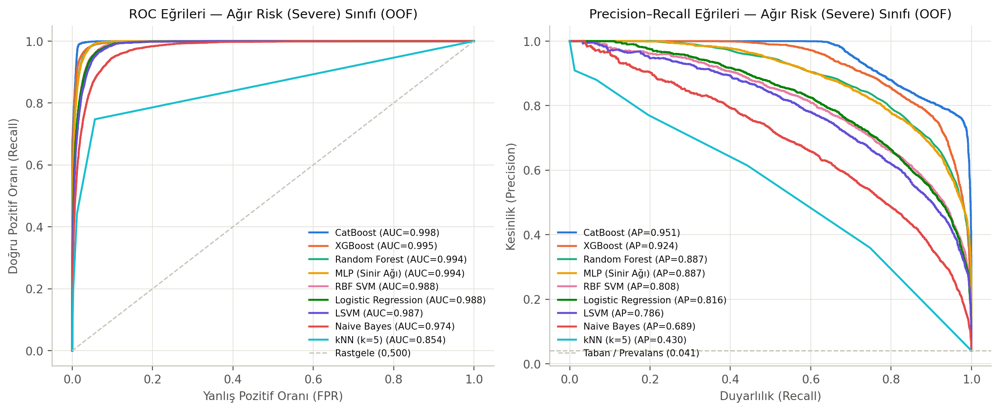
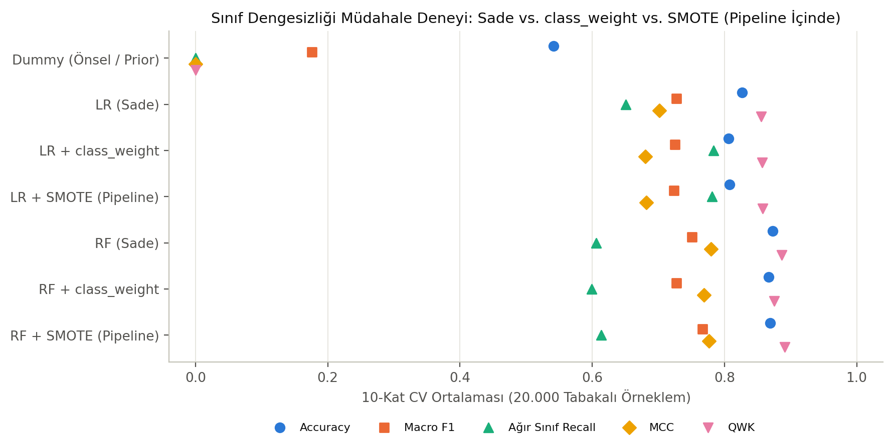

# Makine Öğrenmesi Yöntemleri ile Uyku Bozukluğu Riskinin Sıralı Çok Sınıflı Tahmin Edilmesi

[](https://www.python.org/)
[](https://scikit-learn.org/)
[](https://imbalanced-learn.org/)
[](https://catboost.ai/)
[](https://xgboost.ai/)

> **Yalova Üniversitesi Bilgisayar Mühendisliği — Makine Öğrenmesi Uygulamalı Ders Notu** standartlarına (%100 sızıntısız `Pipeline` + `ColumnTransformer`, `DummyClassifier(strategy="prior")` referansı, `ddof=1`, dengesiz/sıralı hedefe özgü **Macro Recall**, **Macro F1**, **MCC**, **QWK**, **Macro AUROC/AUPR**, sınıf bazlı azınlık tablosu, ≥2 sınıf uzak hata sayımı, Eğitim–CV / `max_depth` / Öğrenme Eğrisi, `class_weight` & Pipeline içi `SMOTE`, SMOTE sızıntı deneyi, 10 eğitim katlamasından CatBoost öznitelik katkı analizi, prevalansa göre varsayımsal **PPV** tablosu, seçim yanlılığı ve dürüst klinik sınırlılıklar) ve **Gazi Üniversitesi Fen Bilimleri Dergisi (GU J Sci, Part C)** makale formatına tam uyumlu akademik çalışma.

---

## 👨‍💻 Yazar
* **Ad Soyad:** Dursun Burak AKYÜZ (`220101005@ogrenci.yalova.edu.tr`)
* **Kurum:** Yalova Üniversitesi, Mühendislik Fakültesi, Bilgisayar Mühendisliği Bölümü
* **Nihai Makale (Word):** [Makine_Ogrenmesi_Ile_Uyku_Bozuklugu_Riski_Tahmini.docx](./Makine_Ogrenmesi_Ile_Uyku_Bozuklugu_Riski_Tahmini.docx) *(Tüm sayılar `tablolar/sonuclar.json` ve `tablolar/*.csv` çıktılarından dinamik olarak okunarak derlenmiştir.)*

---

## 📊 10-Kat StratifiedKFold Sonuçları (100.000 Örnek, `ddof=1`, `random_state=42`)

| Model | Accuracy | Macro Recall | Macro F1 | MCC | QWK | Macro AUROC | Macro AUPR | Log-Loss | Ağır Recall | ≥2 Hata | Süre (sn) |
| :--- | :---: | :---: | :---: | :---: | :---: | :---: | :---: | :---: | :---: | :---: | :---: |
| 🥇 **CatBoost** | **0,9549 ± 0,0013** | **0,8724 ± 0,0043** | **0,8807 ± 0,0038** | **0,9229 ± 0,0023** | **0,9645 ± 0,0011** | **0,9953** | **0,9512** | **0,1038** | **0,8064** | **0** | 37,81 |
| 🥈 **XGBoost** | 0,9434 ± 0,0015 | 0,8418 ± 0,0035 | 0,8604 ± 0,0033 | 0,9028 ± 0,0026 | 0,9541 ± 0,0014 | 0,9912 | 0,9144 | 0,1880 | 0,7619 | 16 | 35,41 |
| 🥉 **Random Forest** | 0,9087 ± 0,0014 | 0,7778 ± 0,0065 | 0,8077 ± 0,0055 | 0,8425 ± 0,0023 | 0,9227 ± 0,0020 | 0,9855 | 0,8840 | 0,2830 | 0,6832 | 72 | 75,38 |
| **MLP (Sinir Ağı)** | 0,8901 ± 0,0023 | 0,8053 ± 0,0099 | 0,8139 ± 0,0064 | 0,8121 ± 0,0036 | 0,9127 ± 0,0018 | 0,9814 | 0,8789 | 0,2536 | 0,7622 | 22 | 202,80 |
| **RBF SVM\*** | 0,8512 ± 0,0028 | 0,7183 ± 0,0086 | 0,7431 ± 0,0071 | 0,7435 ± 0,0049 | 0,8737 ± 0,0032 | 0,9608 | 0,7916 | — | 0,6141 | 147 | 450,83 |
| **Logistic Regression** | 0,8296 ± 0,0020 | 0,7186 ± 0,0067 | 0,7359 ± 0,0051 | 0,7063 ± 0,0033 | 0,8588 ± 0,0024 | 0,9568 | 0,7909 | 0,3922 | 0,6746 | 155 | 13,57 |
| **LSVM** | 0,7886 ± 0,0021 | 0,5506 ± 0,0062 | 0,5590 ± 0,0055 | 0,6238 ± 0,0040 | 0,7427 ± 0,0060 | 0,9352 | 0,7074 | — | 0,4921 | 2.113 | 25,94 |
| **Naive Bayes** | 0,7370 ± 0,0040 | 0,6609 ± 0,0110 | 0,6354 ± 0,0078 | 0,5607 ± 0,0065 | 0,7910 ± 0,0041 | 0,9085 | 0,6534 | 0,8480 | 0,7162 | 794 | 5,09 |
| **kNN (k=5)** | 0,7164 ± 0,0039 | 0,4677 ± 0,0052 | 0,4997 ± 0,0065 | 0,4866 ± 0,0077 | 0,6417 ± 0,0061 | 0,8420 | 0,5537 | 2,3960 | 0,2046 | 3.089 | 78,25 |
| **Dummy (Önsel / Prior)** | 0,5416 ± 0,0001 | 0,2500 ± 0,0000 | 0,1757 ± 0,0000 | 0,0000 ± 0,0000 | 0,0000 ± 0,0000 | 0,5000 | 0,2500 | 1,0353 | 0,0000 | 12.365 | 0,47 |

*\*RBF SVM eğitim katlaması O(N²) karmaşıklığı nedeniyle 25.000 tabakalı örnekle sınırlandırılmıştır; paralellik ayarları algoritmaya göre (1 veya 2 iş parçacığı) farklılık gösterir. CatBoost eşleştirilmiş fold farklarında diğer 8 gerçek modelin tamamına karşı **10-0** üstündür.*

### Öne Çıkan Metodolojik Bulgular
- **Sıralama Değişimleri (Ranking Flips):** Yalnızca Accuracy/MCC'ye bakıldığında gizlenen üç kritik fark ortaya çıktı — **MLP > Random Forest** (`Macro Recall: 0,8053 vs. 0,7778`), **Logistic Regression > RBF SVM** (`Macro Recall: 0,7186 vs. 0,7183`) ve **Naive Bayes > LSVM** (`Macro Recall: 0,6609 vs. 0,5506`, `QWK: 0,7910 vs. 0,7427`).
- **Prevalans–PPV Duyarlılığı (CatBoost Ağır Risk, Sabit Recall=0,8064, Özgüllük=0,9950):** PPV değeri veri setindeki `%4,07` prevalansta `%87,18` iken, varsayımsal `%2` taramada `%76,61`, `%1` taramada `%61,85` ve `%0,5` nadir taramada `%44,65` düzeyine gerilemektedir.
- **Doğrusal Bağımlılık ve Özellik Paylaşımı:** `RSR = deep_sleep_percentage + rem_percentage` tam doğrusal toplam (`r = 0,8097`), `SFI` ↔ `wake_episodes_per_night` ise `r = 0,9197` korelasyonludur; 10 eğitim katlamasından hesaplanan CatBoost katkı paylarında türetilen sütunlar bilgi payını ham bileşenleriyle paylaşmaktadır.

---

## 📈 Temel Grafikler

### 1. Model Karşılaştırması & 2×2 ROC / Precision–Recall Eğrileri (Ağır ve Orta Risk)



### 2. Overfitting (Karmaşıklık Taraması + Öğrenme Eğrileri) & Dengesizlik Deneyi



### 3. Birleşik (OOF) Karmaşıklık Matrisleri & CatBoost (10-Fold) Öznitelik Katkı Payları


---

## 🚀 Yeniden Üretilebilirlik
```bash
pip install -r requirements.txt
python cv_10fold.py
python generate_paper.py
```

> **Klinik ve Metodolojik Uyarı:** Bu çalışma UCI dışı, Kaggle kaynaklı (*Sleep Health and Daily Performance Dataset*) bir veri seti üzerinde eğitim ve yöntem kıyaslama amacıyla yürütülmüştür. Yüksek çapraz doğrulama skorları; dış doğrulama, olasılık kalibrasyonu, seçim yanlılığı kontrolü ve prevalans uyarlaması olmaksızın klinik karar desteği için yeterli değildir.
