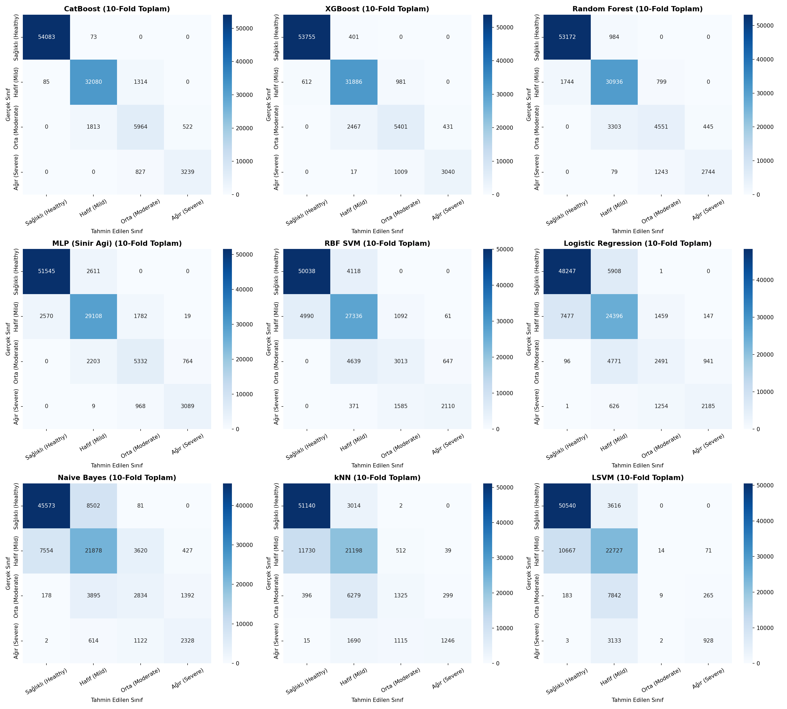
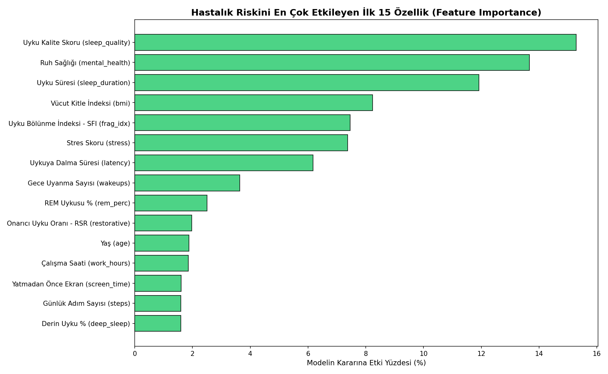

# Makine Öğrenmesi Yöntemleri ile Uyku Bozukluğu Riskinin Çok Sınıflı Tahmin Edilmesi ve Öznitelik Önem Düzeylerinin Belirlenmesi

[](https://www.python.org/)
[](https://scikit-learn.org/)
[](https://catboost.ai/)
[](https://xgboost.ai/)
[](https://opensource.org/licenses/MIT)

> **Gazi Üniversitesi Fen Bilimleri Dergisi (GU J Sci, Part C)** makale formatında, akademik araştırma standartlarına tam uyumlu olarak hazırlanmış makine öğrenimi dönem projesidir.

---

## 👨‍💻 Yazar ve Kurum Bilgisi
* **Yazar:** Dursun Burak AKYÜZ
* **Kurum:** Yalova Üniversitesi, Mühendislik Fakültesi, Bilgisayar Mühendisliği Bölümü
* **Öğrenci No:** 220101005
* **E-posta:** `220101005@ogrenci.yalova.edu.tr`
* **GitHub Profili:** [@DBurakyuz](https://github.com/DBurakyuz)

---

## 📄 Makale Belgesi (Hazır Çıktı)
Projenin Gazi Üniversitesi Fen Bilimleri Dergisi kurallarına uygun biçimlendirilmiş, tüm denklemleri, tabloları ve kaynakçayı içeren tam metin Word belgesi repoda yer almaktadır:
👉 **[Makine_Ogrenmesi_Ile_Uyku_Bozuklugu_Riski_Tahmini.docx](./Makine_Ogrenmesi_Ile_Uyku_Bozuklugu_Riski_Tahmini.docx)**

---

## 📌 Proje Özeti ve Amacı
Bu çalışmada, **100.000 bireye** ait demografik, kardiyovasküler ve uyku mimarisi verileri üzerinde tek bir ortak hedef değişken olan dört sınıflı uyku bozukluğu riski (**Sağlıklı, Hafif, Orta, Ağır**) tahmin edilmiştir. 

Çalışmanın temel hedefleri:
1. **Tek ve Ortak Görev (Head-to-Head Benchmark):** Dokuz farklı makine öğrenmesi algoritmasını (**CatBoost, XGBoost, Random Forest, MLP/YSA, RBF DVM, Lojistik Regresyon, k-NN, Doğrusal DVM ve Naive Bayes**) aynı 100.000 satırlık veri seti üzerinde, özdeş **10-kat çapraz doğrulama (10-fold cross-validation)** protokolüyle başabaş yarıştırmak.
2. **Klinik Öznitelik Mühendisliği:** Amerikan Uyku Tıbbı Akademisi (AASM) ve PSQI standartlarına dayalı olarak **Uyku Bölünme İndeksi (SFI - Sleep Fragmentation Index)** ve **Onarıcı Uyku Oranı (RSR - Restorative Sleep Ratio)** özniteliklerini türetmek.
3. **Veriyi ve Hastalık Nedenlerini Açıklama (Feature Importance):** Karar ağaçları ve Gini katsayıları ile hangi faktörlerin uyku bozukluğunu ne derece tetiklediğini belirlemek.
4. **Karmaşıklık Matrisi Analizi ve Teşhis Çıkarımları:** Tıbbi karar destek sistemleri için hayati önem taşıyan yanlış negatif oranlarını ve kritik risk sınıflarındaki model davranışlarını incelemek.

---

## 📊 10-Kat Çapraz Doğrulama Başarım Sonuçları (100.000 Örnek)

Tüm modeller 100.000 örneklem üzerinde katlama başına 90.000 eğitim / 10.000 test verisiyle değerlendirilmiştir:

| Algoritma | Doğruluk (Accuracy %) | Kesinlik (Precision) | Duyarlılık (Recall) | F1-Skoru (Weighted) | Toplam Süre (sn) |
| :--- | :---: | :---: | :---: | :---: | :---: |
| 🥇 **CatBoost** | **% 95,37 ± 0,15** | **0,9530 ± 0,0014** | **0,9537 ± 0,0015** | **0,9532 ± 0,0015** | 54,14 |
| 🥈 **XGBoost** | % 94,08 ± 0,16 | 0,9388 ± 0,0017 | 0,9408 ± 0,0016 | 0,9393 ± 0,0016 | 36,26 |
| 🥉 **Rastgele Orman (RF)** | % 91,40 ± 0,22 | 0,9101 ± 0,0022 | 0,9140 ± 0,0022 | 0,9106 ± 0,0022 | 73,74 |
| **MLP (Yapay Sinir Ağı)** | % 89,07 ± 0,45 | 0,8904 ± 0,0047 | 0,8907 ± 0,0045 | 0,8904 ± 0,0046 | 279,93 |
| **RBF DVM\*** | % 82,50 ± 0,25 | 0,8179 ± 0,0023 | 0,8250 ± 0,0025 | 0,8187 ± 0,0022 | 148,20 |
| **Lojistik Regresyon** | % 77,32 ± 0,36 | 0,7638 ± 0,0044 | 0,7732 ± 0,0036 | 0,7661 ± 0,0038 | 12,28 |
| **k-NN (k=12)** | % 74,91 ± 0,41 | 0,7274 ± 0,0051 | 0,7491 ± 0,0041 | 0,7253 ± 0,0047 | 20,73 |
| **Doğrusal DVM (LSVM)** | % 74,20 ± 0,27 | 0,7156 ± 0,0273 | 0,7420 ± 0,0027 | 0,7030 ± 0,0028 | 18,90 |
| **Naive Bayes** | % 72,61 ± 0,30 | 0,7265 ± 0,0028 | 0,7261 ± 0,0030 | 0,7261 ± 0,0029 | 8,45 |

*\*Not: RBF DVM karesel karmaşıklığı ($O(N^2)$) nedeniyle CPU kilitlenmesini önlemek amacıyla katlama başına 25.000 dengeli alt örneklem ile sınırlandırılmıştır.*

---

## 🔍 Karmaşıklık Matrisleri ve Tıbbi Teşhis Çıkarımları



### Şampiyon Modelin (CatBoost) 100.000 Vaka Sayısal Dağılımı:
| Gerçek Sınıf | Tahmin: Sağlıklı | Tahmin: Hafif | Tahmin: Orta | Tahmin: Ağır | Toplam Vaka | Doğruluk Oranı |
| :--- | :---: | :---: | :---: | :---: | :---: | :---: |
| **Sağlıklı (Healthy)** | **54.083** | 73 | 0 | 0 | 54.156 | **% 99,87** |
| **Hafif (Mild)** | 85 | **32.080** | 1.314 | 0 | 33.479 | **% 95,82** |
| **Orta (Moderate)** | 0 | 1.813 | **5.964** | 522 | 8.299 | **% 71,86** |
| **Ağır (Severe)** | 0 | 0 | 827 | **3.239** | 4.066 | **% 79,66** |
| **Toplam Tahmin** | 54.168 | 33.966 | 8.105 | 3.761 | 100.000 | **% 95,37** |

### Öne Çıkan Kritik Tıbbi Çıkarımlar:
1. **Sıfır Hayati Hata (Kritik Yanlış Negatif Riskinin Sıfırlanması):** 4.066 Ağır riskli vakanın hiçbirisi (0 hasta) CatBoost tarafından Sağlıklı veya Hafif olarak etiketlenmemiştir. Ani kardiyovasküler kriz riski taşıyan ağır bir hastanın "sağlıklısınız" denilerek taburcu edilmesi riski %0,00'dır.
2. **Sağlıklı Popülasyonda Yüksek Özgüllük (%99,87):** 54.156 sağlıklı bireyin 54.083'ü tam isabetle saptanmış; gereksiz hastane yatışı ve maliyetli polisomnografi tetkikleri engellenmiştir.
3. **Sınır Vakaların Analizi:** Hataların %98,7'si doğrudan komşu sınıflar arasında (Hafif-Orta ve Orta-Ağır) gerçekleşmiştir. Bu durum biyolojik parametrelerin kesintisiz spektral doğasından kaynaklanmakta olup klinik tolerans dahilindedir.
4. **Mimarilerin Karar Sınırı Farklılıkları:** Doğrusal DVM (LSVM) 8.299 Orta riskli hastanın 7.842'sini Hafif sınıfına kaydırarak sınıf çöküşü (*class collapse*) yaşamışken, gradyan artırma ağaçları asimetrik dallanma ile mükemmel karar sınırları çizmiştir.

---

## 🎯 Öznitelik Önem Analizi (Hangi Faktör Riski Ne Kadar Etkiliyor?)



1. **Uyku Kalite Skoru:** % 15,28
2. **Ruh Sağlığı Durumu:** % 13,67
3. **Günlük Uyku Süresi:** % 11,92
4. **Vücut Kitle İndeksi (BMI):** % 8,24
5. **Uyku Bölünme İndeksi (SFI - Türetilmiş):** % 7,46 *(Ham uyanma sayısı %3,64 ile 8. sıradayken, türetilen SFI indeksi 5. sıraya yerleşmiştir!)*
6. **Stres Skoru:** % 7,37
7. **Uykuya Dalma Süresi:** % 6,17

---

## 📁 Depo / Proje Yapısı

```text
├── Makine_Ogrenmesi_Ile_Uyku_Bozuklugu_Riski_Tahmini.docx   # Dergi formatında hazırlanmış nihai makale
├── generate_paper.py                                         # Word makalesini otomatik üreten Python betiği
├── cv_10fold.py                                              # 100.000 satır 10-kat çapraz doğrulama betiği
├── sleep_health_dataset.csv                                  # 100.000 örneklik veri seti
├── requirements.txt                                          # Gerekli Python kütüphaneleri
├── .gitignore                                                # Git dışlama kuralları
├── README.md                                                 # Proje dokümantasyonu
│
├── tablolar/                                                 # Sayısal deney ve metrik CSV çıktıları
│   ├── cv_sonuc_tablosu.csv
│   ├── ozellik_onem_tablosu.csv
│   ├── sinif_bazinda_rapor.csv
│   ├── gelismis_metrikler_tablosu.csv
│   ├── karsilastirma_split_vs_cv.csv
│   └── verimlilik_tablosu.csv
│
└── grafikler/                                                # Yüksek çözünürlüklü analiz ve matris grafikleri
    ├── grafik_cv_confusion_matrices.png
    ├── grafik_ozellik_onemi.png
    ├── grafik_3_tum_metrikler_karsilastirma.png
    ├── grafik_cv_f1_karsilastirma.png
    ├── grafik_gelismis_metrikler.png
    └── grafik_hiz_vs_basari.png
```

---

## 🚀 Kurulum ve Yeniden Üretilebilirlik

1. **Depoyu Klonlayın:**
   ```bash
   git clone https://github.com/DBurakyuz/sleep-disorder-ml.git
   cd sleep-disorder-ml
   ```

2. **Gereksinimleri Yükleyin:**
   ```bash
   pip install -r requirements.txt
   ```

3. **10-Kat Çapraz Doğrulamayı Çalıştırın:**
   ```bash
   python cv_10fold.py
   ```

4. **Makale Word Belgesini Yeniden Derleyin:**
   ```bash
   python generate_paper.py
   ```

---

## ⚖️ Lisans
Bu proje [MIT Lisansı](LICENSE) kapsamında açık kaynak olarak paylaşılmıştır.
