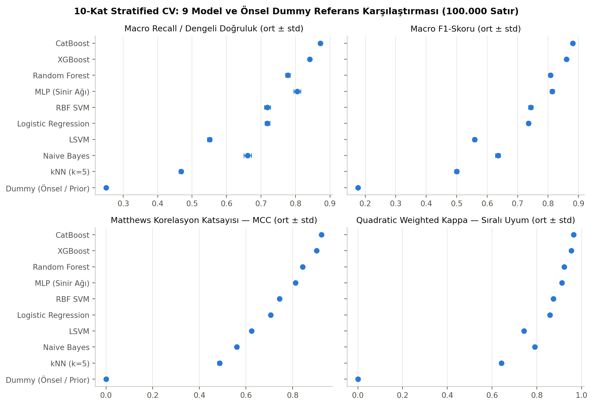
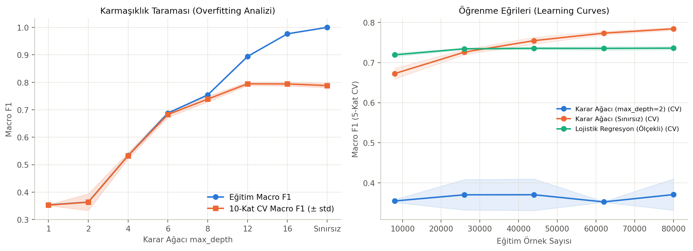
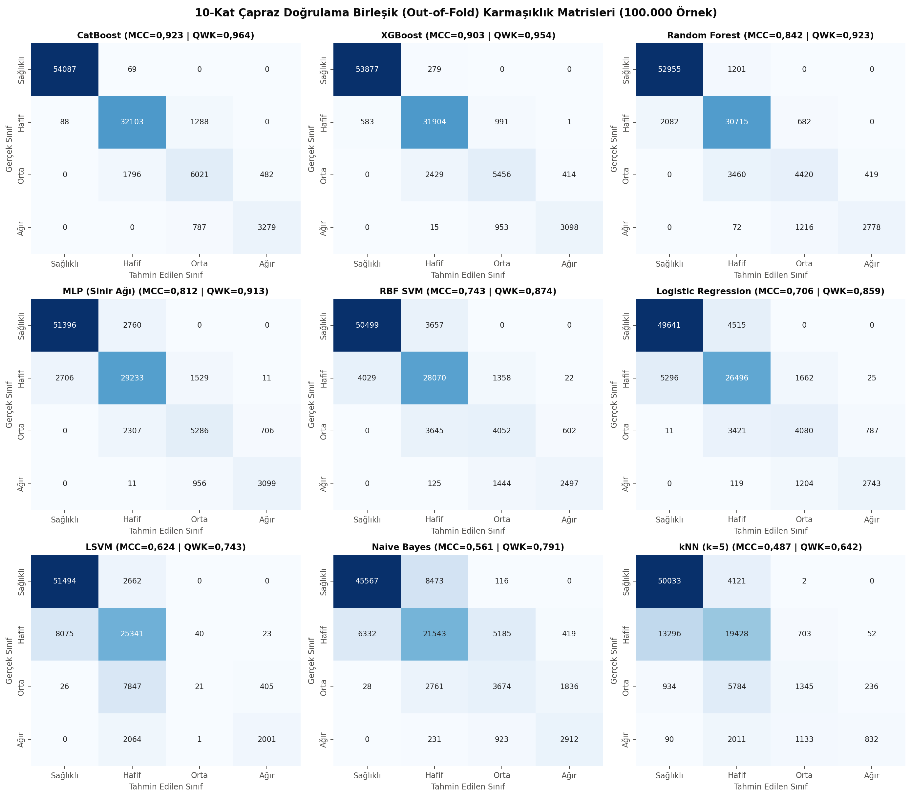
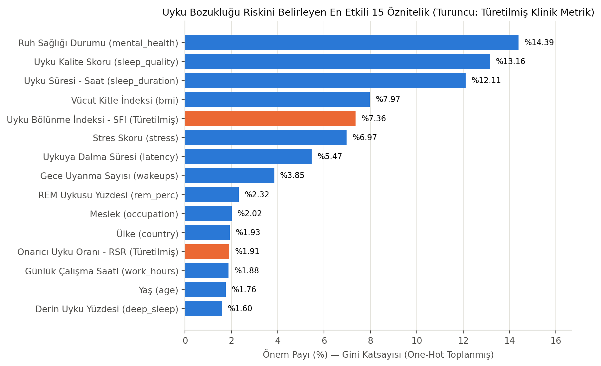

# Makine Öğrenmesi Yöntemleri ile Uyku Bozukluğu Riskinin Çok Sınıflı Tahmin Edilmesi

[](https://www.python.org/)
[](https://scikit-learn.org/)
[](https://imbalanced-learn.org/)
[](https://catboost.ai/)
[](https://xgboost.ai/)

> **Yalova Üniversitesi Bilgisayar Mühendisliği — Makine Öğrenmesi Uygulamalı Ders Notu** standartlarına (%100 sızıntısız `Pipeline` + `ColumnTransformer`, `DummyClassifier` referansı, `ddof=1`, Eğitim–CV / `max_depth` / Öğrenme Eğrisi, `class_weight` & Pipeline içi `SMOTE`, SMOTE sızıntı deneyi, ROC/PR eğrileri, eşleştirilmiş fold farkları `K–Y` ve dürüst klinik sınırlılıklar) ve **Gazi Üniversitesi Fen Bilimleri Dergisi (GU J Sci, Part C)** makale formatına tam uyumlu akademik çalışma.

---

## 👨‍💻 Yazar
* **Ad Soyad:** Dursun Burak AKYÜZ (`220101005@ogrenci.yalova.edu.tr`)
* **Kurum:** Yalova Üniversitesi, Mühendislik Fakültesi, Bilgisayar Mühendisliği Bölümü
* **Nihai Makale (Word):** [Makine_Ogrenmesi_Ile_Uyku_Bozuklugu_Riski_Tahmini.docx](./Makine_Ogrenmesi_Ile_Uyku_Bozuklugu_Riski_Tahmini.docx) *(Tüm sayılar `tablolar/sonuclar.json` ve `tablolar/*.csv` çıktılarından dinamik olarak okunarak derlenmiştir.)*

---

## 📊 10-Kat StratifiedKFold Sonuçları (100.000 Örnek, `ddof=1`, `random_state=42`)

| Model | Accuracy | Weighted F1 | Macro F1 | MCC | AUROC | Macro AUPR | Log-Loss | Süre (sn) |
| :--- | :---: | :---: | :---: | :---: | :---: | :---: | :---: | :---: |
| 🥇 **CatBoost** | **0,9549 ± 0,0013** | **0,9545 ± 0,0014** | **0,8807 ± 0,0038** | **0,9229 ± 0,0023** | **0,9977** | **0,9512** | **0,1038** | 46,30 |
| 🥈 **XGBoost** | 0,9433 ± 0,0015 | 0,9418 ± 0,0014 | 0,8604 ± 0,0033 | 0,9028 ± 0,0026 | 0,9949 | 0,9144 | 0,1880 | 47,33 |
| 🥉 **Random Forest** | 0,9087 ± 0,0014 | 0,9049 ± 0,0015 | 0,8077 ± 0,0055 | 0,8425 ± 0,0023 | 0,9890 | 0,8840 | 0,2830 | 85,36 |
| **MLP (Sinir Ağı)** | 0,8901 ± 0,0023 | 0,8895 ± 0,0021 | 0,8139 ± 0,0064 | 0,8121 ± 0,0036 | 0,9823 | 0,8789 | 0,2536 | 152,78 |
| **RBF SVM\*** | 0,8512 ± 0,0028 | 0,8484 ± 0,0028 | 0,7431 ± 0,0071 | 0,7435 ± 0,0049 | 0,9610 | 0,7916 | — | 407,97 |
| **Logistic Regression** | 0,8296 ± 0,0020 | 0,8273 ± 0,0018 | 0,7359 ± 0,0051 | 0,7063 ± 0,0033 | 0,9520 | 0,7909 | 0,3922 | 13,55 |
| **LSVM** | 0,7886 ± 0,0021 | 0,7534 ± 0,0022 | 0,5590 ± 0,0055 | 0,6238 ± 0,0040 | 0,9305 | 0,7074 | — | 31,40 |
| **Naive Bayes** | 0,7370 ± 0,0040 | 0,7413 ± 0,0036 | 0,6354 ± 0,0078 | 0,5607 ± 0,0065 | 0,8990 | 0,6534 | 0,8480 | 5,05 |
| **kNN (k=5)** | 0,7164 ± 0,0039 | 0,6904 ± 0,0047 | 0,4997 ± 0,0065 | 0,4866 ± 0,0077 | 0,8671 | 0,5537 | 2,3960 | 78,85 |
| **Dummy (Çoğunluk)** | 0,5416 ± 0,0001 | 0,3805 ± 0,0001 | 0,1757 ± 0,0000 | 0,0000 ± 0,0000 | 0,5000 | 0,2500 | 16,5239 | 0,66 |

*\*RBF SVM eğitim katlaması O(N²) karmaşıklığı nedeniyle 25.000 tabakalı örnekle sınırlandırılmıştır. CatBoost eşleştirilmiş fold farklarında diğer tüm modellere karşı **10-0** üstündür.*

---

## 📈 Temel Grafikler

### 1. Model Karşılaştırması & ROC / Precision–Recall Eğrileri



### 2. Overfitting (Karmaşıklık Taraması + Öğrenme Eğrileri) & Dengesizlik Deneyi



### 3. Birleşik (OOF) Karmaşıklık Matrisleri & Öznitelik Önem Düzeyleri



---

## 🚀 Yeniden Üretilebilirlik
```bash
pip install -r requirements.txt
python cv_10fold.py
python generate_paper.py
```

> **Klinik Uyarı:** Bu çalışma eğitim amaçlıdır. Yüksek çapraz doğrulama skorları; dış doğrulama, olasılık kalibrasyonu ve prevalans uyarlaması olmaksızın klinik karar desteği için yeterli değildir.
